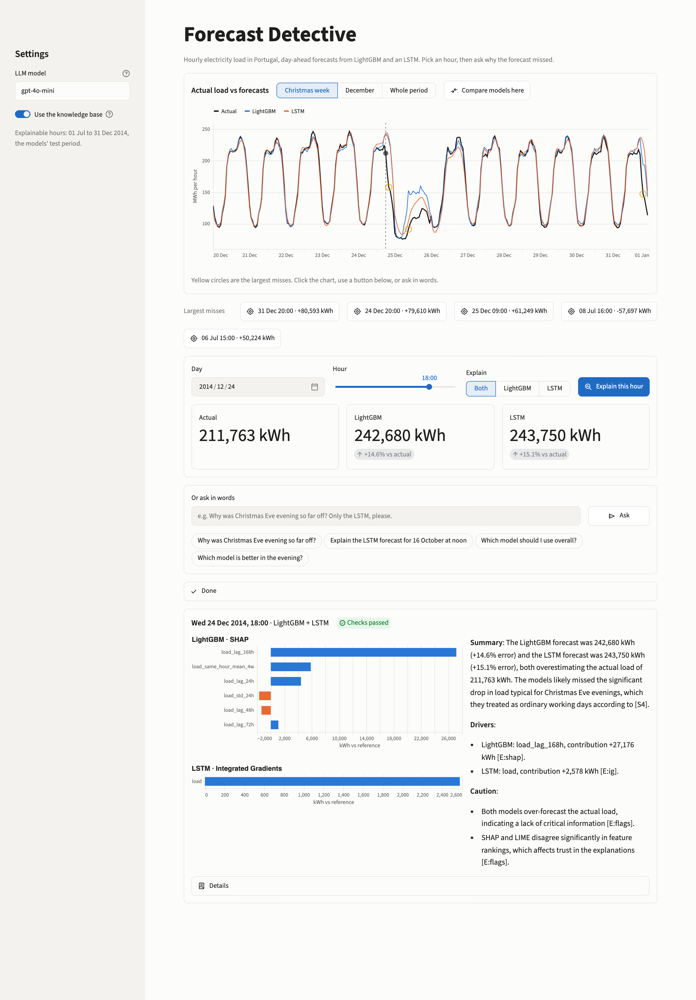
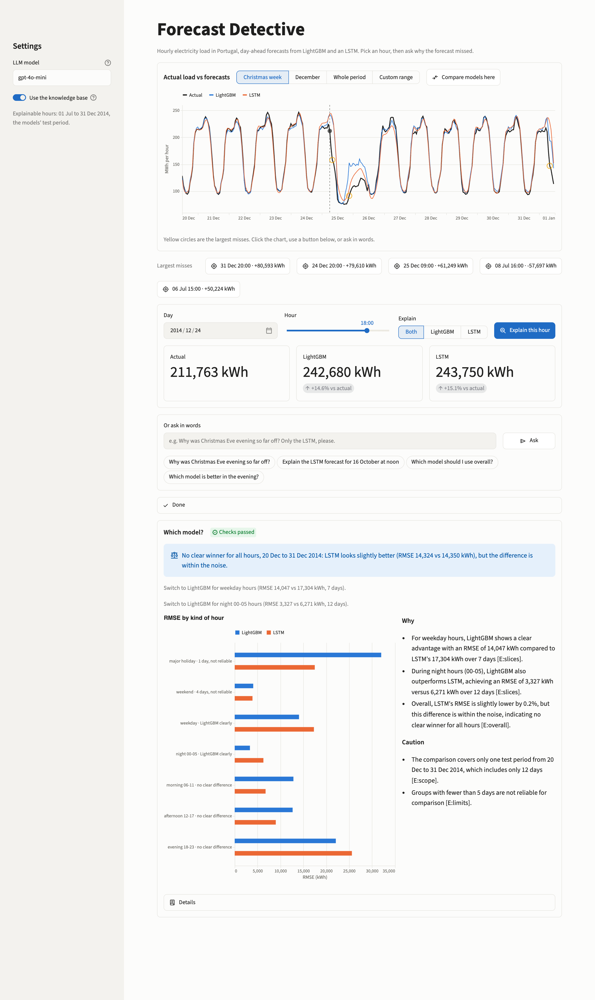

# Forecast Detective

Ask why an electricity-load forecast missed, and get a short answer that cites its evidence and checks itself.

Hourly electricity load for Portugal (UCI *ElectricityLoadDiagrams20112014*, 319 clients added together) is forecast one
day ahead by two models, **LightGBM** and a small **LSTM**. Four explainers (SHAP, LIME, Integrated Gradients, TimeSHAP)
say what each model relied on. A language model turns that into a plain-English explanation, but only from numbers the code
computed, and every number and citation is checked afterwards.



*Explaining Christmas Eve 18:00: both models forecast about 15% too high. Each driver and number in the text is checked against the evidence.*

## What it does

- **Chart-first app.** Actual load against both forecasts, the largest misses circled. Click an hour, press *Explain*.
- **Ask in words.** "Why was the forecast so off on Christmas Eve evening?", "Only the LSTM, please." An agent chooses the hour and model(s).
- **Which model should I use?** A planner compares the two models with a bootstrap over whole days and says *clear*, *no clear difference* or *too few days*, per kind of hour.
- **Cited and checked.** Each sentence cites an evidence block `[E:...]` or a source `[S#]` from the knowledge base. A checker verifies that cited blocks exist and that every number is in the block cited, and retries once on failure.

### Which model should I use?



*The planner on 20 to 31 December. No clear overall winner; LightGBM is clearly better on weekday and night hours; groups with fewer than 5 days are marked not reliable. The window is set with the buttons above the chart, or "Custom range" for any stretch of the test period.*

## Design rule: code decides, the LLM explains

```
question ─► chat agent (tool-calling router, max 8 steps)
              ├─ get_forecasts / explain_hour ─► explanation cache ─► evidence pack ─┐
              └─ recommend_model ─► planner statistics ─► evidence blocks ───────────┤
                                                                                      ├─► RAG (Chroma, top-k)
                                                                                      ├─► ONE writer LLM call
                                                                                      └─► checker (+ one retry)
```

The explainers, retrieval, checker and planner statistics are plain code with tests. The model only writes the wording, so it
cannot change which model wins or add a number the code did not produce.

## Findings on the test period (July to December 2014, 184 days)

Error measure: RMSE in kWh.

| Kind of hour | LightGBM | LSTM | Verdict |
|---|---|---|---|
| All hours | 10,296 | 10,389 | No clear difference (LightGBM lower by 0.9%, 95% interval -6.1% to +6.9%) |
| Night 00-05 | 3,169 | 4,307 | LightGBM clearly better |
| Weekday, weekend, morning, afternoon, evening | within 4.3% | | No clear difference |
| Major holiday (25 Dec) | 32,004 | 17,490 | Too few days: the LSTM looks better, on 1 day, not reliable |

Both models miss the evenings of 24 and 31 December by about 75,000 to 80,000 kWh, which dominates RMSE.

## Limits

- The data is the combined load of 319 clients, not a household. Questions about "my" consumption cannot be answered.
- The models have no weather input. The app explains what the models relied on, not what happened in the world.
- One test period, one Christmas. Groups with fewer than 5 days are never compared.
- The checker cannot see every error: swapped model names, overclaims such as "consistently better", or muddled causes that
  still cite a real source need a person to read the text.

## Run it

Needs Python 3.11, conda (or mamba) and an OpenAI API key for the explanations. Everything else, including the planner's numbers, runs without a key.

```bash
conda env create -f environment.yml
conda activate forecast-explainer
pip install -e .

cp .env.example .env            # then put your OPENAI_API_KEY in .env

python scripts/train_lgbm.py    # downloads the data from UCI on first run, trains LightGBM
python scripts/train_lstm.py    # trains the LSTM
python scripts/build_index.py   # builds the knowledge index (see knowledge/papers/README.md for the PDFs)

streamlit run app/streamlit_app.py
```

Command line:

```bash
python scripts/ask.py "why was the forecast so off on Christmas Eve evening?"
python scripts/recommend.py --no-llm            # the planner's decision and evidence, no API key needed
```

The first explanation of an hour takes about 6 seconds (the explainers run); it is cached afterwards.

## Project layout

| Path | What |
|---|---|
| `src/forecast_explainer/` | The package: data, models, explainers, evidence, RAG, writer, checker, agent, planner |
| `app/streamlit_app.py` | The interactive app |
| `scripts/` | Training, index building and command-line tools |
| `knowledge/notes/` | Domain notes the RAG retrieves (calendar effects, model cards, explainer guide) |
| `eval/` | Retrieval evaluation pairs |
| `tests/` | 151 automated tests (no network, fake LLM) |

Run the tests with `pytest -q`.

## Data and papers

Data: UCI Machine Learning Repository, *ElectricityLoadDiagrams20112014* (downloaded by the code, not stored here).
The papers behind the knowledge base are listed in `knowledge/papers/README.md`.

## License

MIT, see [LICENSE](LICENSE). The data and the papers keep their own terms.
